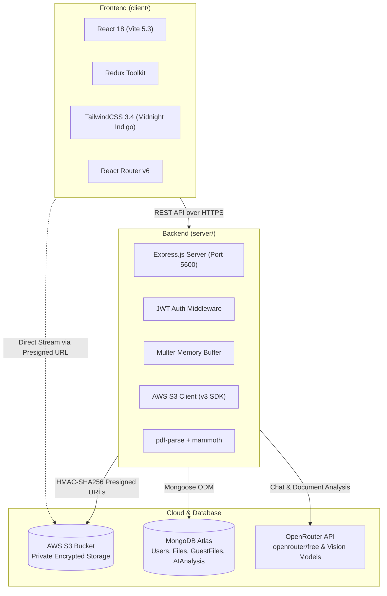

<div align="center">

# 🔐 ShareVault

### Next-Generation Secure File Sharing, Ephemeral Transfers & Document Intelligence Platform

ShareVault is a complete, full-stack web platform built with **React 18**, **Express.js**, **MongoDB**, **AWS S3**, and **OpenRouter AI**. It brings together the speed of instant guest transfers (like WeTransfer) and the security of a personal cloud vault (like Google Drive), while adding an integrated **Document-Grounded AI (RAG)** engine and an automated **Security & PII Scanner**.

**Crafted with ❤️ by [Shivam Rai](https://techwithshivam.in/)**

[](https://react.dev/)
[](https://vitejs.dev/)
[](https://tailwindcss.com/)
[](https://nodejs.org/)
[](https://www.mongodb.com/)
[](https://aws.amazon.com/s3/)
[](https://openrouter.ai/)

</div>

---

## 📑 Table of Contents

- [💡 Project Overview: What is ShareVault?](#-project-overview-what-is-sharevault)
- [🌟 Why ShareVault is Unique (Comparison with Google Drive & WeTransfer)](#-why-sharevault-is-unique)
- [🌐 Protocol Architecture: Why HTTPS/REST & Presigned URLs? (Why NOT FTP?)](#-protocol-architecture-why-httpsrest--presigned-urls-why-not-ftp)
- [🤖 AI Architecture: Does it Use RAG? How Does It Work?](#-ai-architecture-does-it-use-rag-how-does-it-work)
  - [What is RAG in Simple Terms?](#what-is-rag-in-simple-terms)
  - [How Does ShareVault Implement RAG?](#how-does-sharevault-implement-rag)
  - [How Document Summarization Works Step-by-Step](#how-document-summarization-works-step-by-step)
  - [In-Document Grounded Q&A (No Hallucinations)](#in-document-grounded-qa-no-hallucinations)
  - [Multi-Modal Vision: Reading Screenshots & Diagrams](#multi-modal-vision-reading-screenshots--diagrams)
- [🛡️ Security Level: How is the Risk Tier Calculated?](#️-security-level-how-is-the-risk-tier-calculated)
  - [How Does the System Determine LOW, MEDIUM, or HIGH?](#how-does-the-system-determine-low-medium-or-high)
  - [The Dual-Engine Detection Process](#the-dual-engine-detection-process)
  - [Security Risk Scoring Table](#security-risk-scoring-table)
- [🔄 Complete Step-by-Step System Workflows](#-complete-step-by-step-system-workflows)
  - [1. File Upload Workflow (Client → Server → AWS S3 → MongoDB)](#1-file-upload-workflow)
  - [2. File Download & Preview Workflow (Zero Server Bottleneck)](#2-file-download--preview-workflow)
  - [3. AI Document Analysis & Caching Workflow](#3-ai-document-analysis--caching-workflow)
- [📱 Complete Screen & Feature Walkthrough](#-complete-screen--feature-walkthrough)
- [🏗 Architecture & Technology Stack](#-architecture--technology-stack)
- [📁 Project Directory Structure](#-project-directory-structure)
- [🚀 Quickstart Guide (How to Run Locally)](#-quickstart-guide)
- [🧪 Testing & CI](#-testing--ci)
- [🔌 Complete API Reference](#-complete-api-reference)
- [🔒 Security Best Practices Implemented](#-security-best-practices-implemented)
- [🛠 Troubleshooting & FAQs](#-troubleshooting--faqs)
- [📜 License](#-license)

---

## 💡 Project Overview: What is ShareVault?

**ShareVault** is a modern file sharing and document intelligence platform designed to solve a very common problem: **sharing files securely without friction, while knowing exactly what is inside them before downloading**.

### The Problem ShareVault Solves:
1. **Friction in traditional drives**: Sending a document via Google Drive or Dropbox often requires making sure permissions are set correctly, forcing recipients to log in or request access.
2. **Blind file transfers**: When someone receives a 60-page PDF, a legal contract, or a code file via typical transfer tools (like WeTransfer), they have to download the file blindly without knowing if it contains sensitive passwords, private API keys, or what the document actually covers.
3. **Security risks**: Users frequently share documents that accidentally contain sensitive data like personal phone numbers, bank details, or API keys without realizing it.

### The ShareVault Solution:
- **Instant Guest Sharing**: Send files immediately without signing up. Get an expiring short link and a QR code.
- **Personal Cloud Vault**: Registered users get their own dashboard with file metrics, download analytics, and storage counters.
- **Built-in AI Document Reader (RAG)**: Automatically summarizes PDFs, Word files, and text documents, pulls out keywords, and lets you ask questions directly about the file.
- **Automatic Security & Privacy Scan**: Scans files for exposed API keys, credit card numbers, passwords, and emails, assigning an automated security risk score (**LOW**, **MEDIUM**, or **HIGH**).
- **Direct Cloud Streaming (No Server Overload)**: Uses AWS S3 Presigned URLs so users stream and preview files directly from the cloud without passing heavy traffic through the backend server.

---

## 🌟 Why ShareVault is Unique?

### Quick Comparison Table

| Feature / Capability | Google Drive / Dropbox | WeTransfer | ShareVault |
| :--- | :--- | :--- | :--- |
| **Instant Guest Sharing** | ❌ Requires account & login | ✅ Yes (ephemeral links) | ✅ **Yes (No signup required)** |
| **Personal Vault & Dashboard**| ✅ Yes | ❌ No persistent dashboard | ✅ **Yes (Full file manager)** |
| **Automatic PII & Secret Scan**| ❌ No | ❌ No | ✅ **Yes (Detects API keys, cards, phone, email)** |
| **Document-Grounded AI (RAG)** | ❌ Paid enterprise add-on | ❌ No | ✅ **Yes (Chat directly with your documents)** |
| **Instant Executive Summaries**| ❌ No | ❌ No | ✅ **Yes (Summary, type & key tags)** |
| **Direct Cloud Streaming** | ⚠️ Heavy web app interface | ⚠️ Server relay | ✅ **Yes (AWS S3 Presigned URLs)** |
| **Dynamic Mobile QR Handover** | ❌ No | ⚠️ Rare / Paid | ✅ **Yes (Instant high-res QR code)** |
| **Interactive AI Assistant** | ❌ No | ❌ No | ✅ **Yes (Floating Vault Assistant)** |
| **Bcrypt Password Gate on Files**| ⚠️ Complex link permissions | ⚠️ Paid tier only | ✅ **Yes (Free, salted bcrypt hashing)** |
| **Custom Time Expiry (TTL)** | ⚠️ Complex sharing policies | ⚠️ Fixed days | ✅ **Yes (Set custom hours or exact dates)** |

---

## 🌐 Protocol Architecture: Why HTTPS/REST & Presigned URLs? (Why NOT FTP?)

In networking, **FTP (File Transfer Protocol)** was originally created in 1971 to move files between computers. Today, ShareVault uses **HTTPS (TLS 1.3), REST APIs, and AWS S3 Presigned URLs** instead.

```
                    ┌────────────────────────────┐
                    │  User Browser / Mobile App │
                    └─────────────┬──────────────┘
                                  │
                       HTTPS Request (Port 443)
                       "I want to view file /f/abc"
                                  ▼
                    ┌────────────────────────────┐
                    │   ShareVault Express API   │
                    │   (Validates Password/TTL) │
                    └─────────────┬──────────────┘
                                  │
                 Generates S3 Presigned URL (SigV4)
                 Valid for only 15 minutes
                                  │
                                  ▼
    ┌────────────────────────────────────────────────────────────┐
    │ User Browser downloads or streams directly from AWS S3     │
    │ (Server bandwidth remains 100% free for other users)       │
    └────────────────────────────────────────────────────────────┘
```

### Simple Explanation of the Protocols Used:
1. **HTTPS (Port 443)**: Think of HTTPS as an armored, tamper-proof courier truck. Every piece of information sent between your browser and our server is scrambled using strong cryptographic ciphers (TLS 1.3). Nobody eavesdropping on the Wi-Fi network can read your passwords, files, or links.
2. **REST API**: A clean, standard way for the React frontend to speak with the Express backend using regular web requests (`GET`, `POST`, `DELETE`) with JSON data.
3. **AWS S3 Presigned URLs**: Think of a Presigned URL like a **temporary VIP digital pass**. When a user requests a file, our server creates a special link directly to AWS cloud storage that is signed with a secret key and expires after a short time (e.g., 15 minutes). The user downloads or streams directly from AWS.

---

### Detailed Comparison: Why Did We NOT Use FTP?

| Architectural Vector | Legacy FTP (`ftp://`) | ShareVault (`https://` + AWS S3 Presigned URLs) | Why This Matters in Simple Words |
| :--- | :--- | :--- | :--- |
| **1. Data Encryption in Transit** | **Unencrypted Plaintext**. Passwords, commands, and file contents travel across the internet in clear text. | **Full End-to-End Encryption (TLS 1.3)**. Every byte is encrypted using AES-256-GCM. | Anyone on the same public Wi-Fi using tools like Wireshark can read FTP transfers. HTTPS guarantees privacy. |
| **2. Ephemeral Expiring Links** | **No link expiration concept**. FTP requires creating permanent user accounts on the server machine. | **Cryptographic Time-To-Live (TTL)**. Presigned links stop working automatically after their timer expires. | With ShareVault, you can share a link that expires in 1 hour without having to create or delete user accounts. |
| **3. Firewall & Router Compatibility** | **Firewall Nightmare**. FTP opens two connections: Port 21 for commands and random high ports (1024-65535) for data. Firewalls frequently block it. | **Standard Port 443**. Runs over standard HTTPS traffic without requiring special router settings. | FTP fails on many college, office, and mobile hotspot networks. ShareVault works everywhere seamlessly. |
| **4. Browser Support** | **Permanently Deprecated**. Chrome, Firefox, Safari, and Edge have removed support for `ftp://` links. | **100% Native Web & Mobile Support**. Works out-of-the-box in all browsers without extra software. | To use FTP, users must install desktop software like FileZilla. ShareVault opens instantly in any browser. |
| **5. In-Browser Media Previews** | **Cannot stream or preview**. Users must download the entire file to their hard drive before opening it. | **Native In-Browser Streaming**. Supports video seeking, audio streaming, and PDF rendering directly in the tab. | You can watch a video or inspect a PDF without waiting to download hundreds of megabytes. |
| **6. Server Bandwidth & Scalability** | **Server Bottleneck**. All file bytes pass directly through the server's CPU and internet connection. | **Zero-Load Server Architecture**. File bytes travel directly between AWS cloud storage and the user. | If 100 users download a 1 GB file, an FTP server crashes. ShareVault handles it effortlessly via AWS. |
| **7. Access Control Granularity** | **Server-Wide Accounts**. FTP permissions apply to folders on the operating system. | **Per-File Security**. Every individual file has its own unique short link, password hash, and expiration clock. | Complete control over each file without managing complex server operating system permissions. |

---

## 🤖 AI Architecture: Does it Use RAG? How Does It Work?

### What is RAG in Simple Terms?

**RAG stands for Retrieval-Augmented Generation.**

> **The Open-Book Exam Analogy:**
> - When you ask a normal AI model a question, it answers from memory (like a student taking a closed-book exam). Sometimes the AI misremembers or makes things up (this is called an **AI hallucination**).
> - With **RAG**, the AI is taking an **open-book exam**. We give the AI the exact text extracted from your uploaded file and say: *"Answer the user's question using ONLY the facts written on these pages. If the answer is not in this document, say you cannot find it."*

---

### How Does ShareVault Implement RAG?

ShareVault uses a **Document-Grounded RAG architecture** designed specifically for file sharing:

```
[Uploaded File: PDF / DOCX / TXT / Image]
                    │
                    ▼
     [1. Text Extraction Layer]
     • PDF: pdf-parse extracts text and page numbers
     • Word: mammoth extracts text and tables
     • Text/Code: UTF-8 stream decoder
     • Images: Base64 vision buffer
                    │
                    ▼
     [2. Context Cleaning & Window Budgeting]
     • Removes binary noise and control characters
     • Budgets clean text window (up to 40,000 characters)
                    │
                    ▼
     [3. Grounded Prompt Formulation]
     • Injects document text as the single source of truth
     • Sets AI temperature to 0.1 (strict, deterministic)
     • Enforces: "Never guess. Never use outside information."
                    │
                    ▼
     [4. OpenRouter AI Processing (openrouter/free)]
                    │
         ┌──────────┴──────────┐
         ▼                     ▼
[Executive Summary]     [Grounded Answers]
JSON: Summary, type,    Answering questions
keywords, risk level    strictly from file
         │                     │
         └──────────┬──────────┘
                    ▼
     [5. MongoDB AIAnalysis Cache]
     Stored with fileId for instant future loading
```

---

### How Document Summarization Works Step-by-Step

When a user clicks **"Analyze with AI"** on any file:

1. **Step 1: Text Extraction**:
   - The backend checks the file extension.
   - If it is a **PDF**, `pdf-parse` reads the file buffer and extracts all raw text while counting pages.
   - If it is a **DOCX**, `mammoth` extracts the document's text and table rows.
   - If it is a **code file or plain text** (`.js`, `.py`, `.json`, `.txt`), it decodes the UTF-8 text directly.
2. **Step 2: Structured Instruction Prompt**:
   - The server builds a prompt asking OpenRouter to examine the document:
     - Produce an executive summary (up to 4,000 characters).
     - Classify the document type (`academic`, `code`, `legal`, `invoice`, `image`, or `other`).
     - Extract up to 15 key topical keywords.
     - Scan for sensitive data (API keys, passwords, phone numbers, credit cards, emails).
     - Assign a security risk level (`LOW`, `MEDIUM`, or `HIGH`).
3. **Step 3: Strict JSON Output**:
   - The AI is instructed to reply strictly in valid JSON format without conversational preamble.
4. **Step 4: Resilient Parsing & Sanitization**:
   - The custom parser (`parseJsonBlock`) strips away any markdown formatting and extracts the clean JSON object.
   - The validator (`validateAnalysis`) validates that all fields are clean and properly typed.
5. **Step 5: Database Caching**:
   - The result is stored in the MongoDB `AIAnalysis` collection. If the user closes and re-opens the modal, the summary loads instantly in 0 milliseconds without re-calling the AI API.

---

### In-Document Grounded Q&A (No Hallucinations)

Inside the **AI Analysis Modal**, users can switch to the **Q&A Tab** to ask questions about the document:
- Example: *"What is the refund policy mentioned on page 3?"*
- Example: *"What port does this configuration file specify?"*

The backend passes your question along with the exact document text into the model with **temperature clamped to 0.1** (very strict). If the answer cannot be found in the document, the AI will honestly reply:
> *"I could not find this information in the uploaded document."*

This completely prevents the AI from making up false statements.

---

### Multi-Modal Vision: Reading Screenshots & Diagrams

In the **Vault Assistant** chat widget on the user dashboard:
- Users can attach images (PNG, JPEG, screenshots of error messages, UI designs, or receipts).
- The file is converted into a base64 data URL and sent to the vision model (`OPENROUTER_VISION_MODEL`).
- The assistant reads text inside images (OCR), explains diagrams, and debugs code snippets shown in screenshots.

---

## 🛡️ Security Level: How is the Risk Tier Calculated?

### How Does the System Determine LOW, MEDIUM, or HIGH?

Every file analyzed receives an automated security badge: **LOW**, **MEDIUM**, or **HIGH**.

ShareVault uses a **Dual-Engine Inspection system** to evaluate security risk:

```
[Document Text Stream]
          │
          ├───► Engine 1: Deterministic Regex Scanner (Exact Rules)
          │     Checks for known secrets:
          │     • API keys (OpenAI 'sk-...', AWS 'AKIA...', GitHub 'ghp_...')
          │     • Passwords and authentication tokens
          │     • 16-digit credit card patterns
          │     • Phone numbers and email addresses
          │
          └───► Engine 2: Semantic Intent Classifier (AI Evaluation)
                Checks for confidential meaning:
                • Non-Disclosure Agreements (NDAs)
                • Internal trade secrets or proprietary memos
                • Financial accounting statements
```

---

### Security Risk Scoring Table

| Risk Level | Visual Badge | Detected Triggers | Real-World Examples | What Should You Do? |
| :---: | :---: | :--- | :--- | :--- |
| **LOW** | <span style="background-color:#064e3b;color:#34d399;padding:3px 8px;border-radius:4px;font-weight:bold;">🟢 LOW</span> | • **0** active credentials or API keys.<br>• **0** financial accounts or passwords.<br>• Non-confidential content. | College notes, public blog drafts, marketing flyers, open-source code. | Safe to share publicly or via guest short links. |
| **MEDIUM** | <span style="background-color:#713f12;color:#facc15;padding:3px 8px;border-radius:4px;font-weight:bold;">🟡 MEDIUM</span> | • Contains non-critical contact info (email addresses, phone numbers).<br>• Internal business memos without passwords.<br>• Invoices with billing names. | Resumes containing phone numbers and personal emails, project task lists, client invoices. | **Add a password** and set an **expiry time** (e.g., 24 hours). |
| **HIGH** | <span style="background-color:#7f1d1d;color:#f87171;padding:3px 8px;border-radius:4px;font-weight:bold;">🔴 HIGH</span> | • **Active API keys, database URLs, or secret tokens**.<br>• Plaintext passwords or credentials.<br>• Credit card numbers or confidential legal NDAs. | `.env` files with database credentials, private keys, financial statements, contracts with strict NDAs. | **Never share openly!** Lock with a strong password, set short expiry, or remove secrets before sending. |

---

## 🔄 Complete Step-by-Step System Workflows

### 1. File Upload Workflow

```
[User Browser]
      │  1. Drags & drops files onto React Dropzone
      │  2. Optionally sets password and expiry duration
      ▼
[React Frontend]
      │  3. Packages files into multipart/form-data
      │  4. Sends POST request to /api/files/upload (or /upload-guest)
      ▼
[Express Server]
      │  5. Multer intercepts file and buffers it directly into memory (RAM)
      │  6. Generates unique S3 key: originalName_shortid.extension
      │  7. Sends stream directly to AWS S3 bucket
      ▼
[AWS S3 Bucket]
      │  8. Stores object in private encrypted bucket
      │  9. Returns S3 file URL to Express
      ▼
[MongoDB Atlas]
      │  10. Saves File document (name, size, type, shortCode, passwordHash, expiresAt)
      ▼
[User Browser]
      │  11. Receives clean short URL (/f/:code) & dynamic QR code
```

---

### 2. File Download & Preview Workflow

```
[Recipient Browser]
      │  1. Visits short link: https://sharevault.com/f/abc123xyz
      ▼
[Express Server]
      │  2. Looks up file by shortCode in MongoDB
      │  3. Checks expiration: Has expiresAt passed?
      │     └── If YES: Returns 410 Gone ("File Expired")
      │  4. Checks password: Is isPasswordProtected true?
      │     └── If YES: Prompts user for password & checks with bcrypt
      │  5. Generates AWS S3 Presigned URL (valid for 15 minutes)
      ▼
[Recipient Browser]
      │  6. Receives the temporary Presigned URL
      │  7. Connects directly to AWS S3:
      │     • If Previewing: Streams PDF, video, audio, or image inline in the browser
      │     • If Downloading: Downloads file to hard drive
```

---

### 3. AI Document Analysis & Caching Workflow

```
[User Dashboard]
      │  1. User clicks "Analyze with AI" button on file card
      ▼
[Express Server (/api/ai/analyze/:fileId)]
      │  2. Checks MongoDB AIAnalysis collection: Is analysis already cached?
      │     └── If YES: Returns cached result immediately in <50ms
      │     └── If NO: Proceeds to extraction
      │  3. Downloads file stream from S3
      │  4. Runs text extractor (pdf-parse for PDF, mammoth for Word)
      │  5. Runs Heuristic Regex Scanner (finds API keys, cards, phone, email)
      │  6. Sends text payload to OpenRouter AI (openrouter/free)
      │  7. Parses structured JSON (summary, classification, keywords, risk level)
      │  8. Saves complete report into MongoDB AIAnalysis collection
      ▼
[React Frontend]
      │  9. Displays interactive modal with Summary, Security Badges, and Q&A Tab
```

---

## 📱 Complete Screen & Feature Walkthrough

### 1. Landing Page & Guest Sharing
- **Instant Drag & Drop**: Upload files immediately without an account.
- **Expiry Options**: Choose between 1 hour, 6 hours, 24 hours, or custom duration.
- **Password Protection**: Optionally set a password to lock the file.
- **Copyable Short Link & Dynamic QR Code**: Displayed instantly upon upload completion.
- **Public Assistant**: A friendly AI chatbot in the corner ready to answer questions about how ShareVault works.

### 2. User Authentication
- **Secure Registration & Login**: Account creation with email and password.
- **JWT Token Management**: Stateless authorization tokens with safe automatic expiration.

### 3. Personal Vault Dashboard
- **Storage Metrics**: Visual meters showing used storage and remaining quota.
- **Activity Counters**: Total uploads, total downloads, and active shared links.
- **Files Table**: Search by file name, filter by status, sort by date.
- **Quick File Actions**:
  - 🔗 Copy shareable short link.
  - 📱 View/download high-resolution QR code.
  - 👁️ Open in-browser rich media preview.
  - 🤖 Trigger AI Document Intelligence modal.
  - ⏳ Update or extend file expiration.
  - 🔑 Change or remove password protection.
  - 🗑️ Permanently delete file from S3 and MongoDB.

### 4. Rich Media Previewer
- **Images**: In-browser lightbox viewer with zoom controls (0.5x to 4x), rotate, and fullscreen mode.
- **PDF Documents**: Embedded PDF reader with page navigation and zoom.
- **Video & Audio**: HTML5 player supporting MP4, MOV, WEBM, MP3, and WAV with seekable scrub bar.
- **Code & Text**: Code viewer for JavaScript, Python, JSON, Markdown, and plain text files.

### 5. Interactive AI Modal (On Any Document)
- **Executive Summary Tab**: Clear summary of what the document covers.
- **Classification Badge**: Tags document as `Academic`, `Code`, `Legal`, `Invoice`, etc.
- **Keywords Tags**: Pill tags displaying key topical terms.
- **Security Assessment Card**: Visual risk meter (`LOW`, `MEDIUM`, `HIGH`) and a list of detected sensitive items.
- **Grounded Q&A Tab**: Chat box to ask questions directly about the file with guaranteed zero-hallucination answers.

### 6. Floating Dashboard Vault Assistant
- **AI File Manager Agent**: A conversational AI widget docked on the dashboard.
- **Autonomous Actions**: Can find files, provide storage summaries, and initiate file deletion or expiry updates.
- **Vision & File Attachments**: Users can attach images or documents to the chat for instant visual analysis.

---

## 🏗 Architecture & Technology Stack



### Complete Tech Stack Breakdown

| Technology | Purpose | Why It Was Chosen |
| :--- | :--- | :--- |
| **React 18** | Frontend UI Framework | Component-based, fast virtual DOM, excellent ecosystem. |
| **Vite 5.3** | Frontend Build Tool | Near-instant hot module replacement (HMR) and fast build times. |
| **TailwindCSS 3.4** | Styling | Modern utility-first CSS with dark mode and responsive design. |
| **Redux Toolkit** | State Management | Predictable state flow for authentication, file lists, and AI messages. |
| **Node.js & Express**| Backend REST API | Asynchronous I/O, fast execution, lightweight event-driven model. |
| **MongoDB & Mongoose**| Database | Flexible JSON-like document store ideal for files and AI analysis objects. |
| **AWS S3** | Cloud Object Storage | Industry standard for secure, highly durable, scalable file storage. |
| **OpenRouter AI** | LLM Gateway | Flexible model routing with access to free and vision-capable LLMs. |
| **pdf-parse & mammoth**| Document Parsing | In-memory text extraction from PDF and Word files without disk writes. |
| **bcryptjs** | Password Hashing | Slow cryptographic hashing with salt rounds to resist brute-force attacks. |
| **jsonwebtoken (JWT)**| Authentication | Stateless, secure, token-based user authentication. |

---

## 📁 Project Directory Structure

```
sharevault/
├── client/                              # React 18 Single Page Application
│   ├── src/
│   │   ├── components/
│   │   │   ├── Auth/                    # Route Guards (RequireAuth, NotRequireAuth)
│   │   │   ├── Dashboard/               # Authenticated User Dashboard
│   │   │   │   ├── FileUpload/          # Drag-and-drop multi-file uploader
│   │   │   │   ├── AIAnalysisModal.jsx  # Grounded RAG Summary, Security & Q&A Modal
│   │   │   │   ├── VaultAssistant.jsx   # Interactive Dashboard AI Assistant
│   │   │   │   ├── FileShow.jsx         # User File Table & Actions
│   │   │   │   ├── ActivityFeed.jsx     # Upload & Download Activity Log
│   │   │   │   └── Settings.jsx         # Account Preferences & Profile
│   │   │   ├── Guest/                   # Anonymous Sharing Components
│   │   │   │   ├── Download/            # Guest Download & Media Viewer
│   │   │   │   ├── GuestFileUpload.jsx  # Landing Page Quick Uploader
│   │   │   │   └── PublicAssistant.jsx  # Landing Page Chatbot
│   │   │   ├── AIIcon.jsx               # Glowing AI Starburst Vector Icon
│   │   │   ├── Logo.jsx                 # ShareVault Animated Brand Logo
│   │   │   ├── DownloadPage.jsx         # Authenticated Download & Preview View
│   │   │   ├── Login.jsx & Signup.jsx   # Authentication Views
│   │   │   └── HeaderComp.jsx / Footer  # Navigation & Footer Components
│   │   ├── redux/                       # Redux State Management Slices
│   │   ├── config/axiosInstance.js      # Centralized Axios HTTP Interceptor
│   │   ├── index.css                    # Midnight Indigo Design Tokens & Utilities
│   │   └── toast.css                    # Notification Toast Styling
│   ├── vite.config.js                   # Vite Dev Server with /api Proxy
│   └── package.json
│
├── server/                              # Express REST API Server
│   ├── src/
│   │   ├── controllers/
│   │   │   ├── ai.controller.js         # AI Chat, Document Analysis & Grounded Q&A
│   │   │   ├── file.controller.js       # File Upload, S3 Presigning, Expiry & Verification
│   │   │   └── user.controller.js       # Auth, Registration, Login & Profile
│   │   ├── models/
│   │   │   ├── aiAnalysis.models.js     # AI Analysis Cache Schema
│   │   │   ├── file.models.js           # User Files Schema
│   │   │   ├── guestFile.models.js      # Guest Files Schema
│   │   │   └── user.models.js           # User Account Schema
│   │   ├── middlewares/
│   │   │   ├── auth.middlewares.js      # JWT Token Verification Middleware
│   │   │   └── upload.middlewares.js    # Multer In-Memory Storage Middleware
│   │   ├── routes/
│   │   │   ├── ai.routes.js             # /api/ai Routes
│   │   │   ├── file.routes.js           # /api/files Routes
│   │   │   └── user.routes.js           # /api/users Routes
│   │   ├── services/
│   │   │   ├── aiService.js             # OpenRouter Client, RAG & Heuristic Scanner
│   │   │   └── pdfService.js            # PDF & DOCX In-Memory Text Extractors
│   │   ├── config/                      # AWS S3 & MongoDB Connection Clients
│   │   └── index.js                     # Express Server Setup & Route Mounting
│   ├── .env                             # Server Environment Variables
│   └── package.json
│
├── package.json                         # Root Monorepo Management Scripts
└── README.md                            # Comprehensive Documentation
```

---

## 🚀 Quickstart Guide

### Prerequisites
- **Node.js**: v22 (see `.nvmrc`)
- **MongoDB**: Local MongoDB instance or free MongoDB Atlas URI
- **AWS S3**: An S3 bucket with an IAM user credentials
- **OpenRouter API Key**: Free key from [openrouter.ai](https://openrouter.ai/)

---

### Step 1: Clone the Repository

```bash
git clone https://github.com/shivamrai24/sharevault.git
cd sharevault
```

---

### Step 2: Install All Dependencies

```bash
npm install
```
*(This automatically installs dependencies for both `client/` and `server/` via postinstall script).*

---

### Step 3: Configure Environment Variables

Create a `.env` file in the **root directory** and in the **`server/` directory**:

```env
# ==========================================
# Server Configuration
# ==========================================
PORT=5600
NODE_ENV=development
CLIENT_URL=http://localhost:8080

# ==========================================
# Database & Authentication
# ==========================================
MONGODB_URI=mongodb+srv://<username>:<password>@cluster.mongodb.net/sharevault?retryWrites=true&w=majority
JWT_SECRET=your_super_secret_jwt_key_here

# ==========================================
# AWS S3 Cloud Storage
# ==========================================
AWS_ACCESS_KEY_ID=your_aws_access_key_id
AWS_SECRET_ACCESS_KEY=your_aws_secret_access_key
AWS_REGION=your_aws_region
AWS_BUCKET_NAME=your_s3_bucket_name

# ==========================================
# ShareVault AI (OpenRouter)
# ==========================================
OPENROUTER_API_KEY=sk-or-v1-your_openrouter_api_key_here
OPENROUTER_MODEL=openrouter/free
OPENROUTER_VISION_MODEL=openrouter/free
```

---

### Step 4: Run the Application

Start both the frontend and backend with a single command:

```bash
npm run dev:all
```

- **Frontend Client**: `http://localhost:8080`
- **Backend API**: `http://localhost:5600`

---

## 🔌 Complete API Reference

### 1. Authentication Endpoints (`/api/users`)

| Method | Endpoint | Description | Auth Required |
| :--- | :--- | :--- | :--- |
| `POST` | `/api/users/register` | Create a new user account | No |
| `POST` | `/api/users/login` | Log in and receive a signed JWT token | No |
| `GET` | `/api/users/user/:userId` | Get user profile and account statistics | Yes (JWT) |

---

### 2. File Operations Endpoints (`/api/files`)

| Method | Endpoint | Description | Auth Required |
| :--- | :--- | :--- | :--- |
| `POST` | `/api/files/upload` | Upload multiple files for authenticated user | Yes (JWT) |
| `POST` | `/api/files/upload-guest` | Upload files as an anonymous guest | No |
| `GET` | `/api/files/getUserFiles/:userId`| Get all files belonging to user | Yes (JWT) |
| `GET` | `/api/files/f/:shortCode` | Resolve user short link & generate S3 presigned URL | No |
| `GET` | `/api/files/g/:shortCode` | Resolve guest short link & generate S3 presigned URL | No |
| `POST` | `/api/files/verifyFilePassword` | Verify password candidate for locked file | No |
| `POST` | `/api/files/verifyGuestFilePassword`| Verify password candidate for locked guest file | No |
| `DELETE` | `/api/files/delete/:fileId` | Permanently delete file from S3 and MongoDB | Yes (JWT) |
| `GET` | `/api/files/generateQR/:fileId` | Generate dynamic high-resolution QR code image | No |
| `POST` | `/api/files/updateFileExpiry` | Update or extend file expiration time | Yes (JWT) |
| `POST` | `/api/files/updateFilePassword` | Update or remove password protection | Yes (JWT) |

---

### 3. AI Intelligence Endpoints (`/api/ai`)

| Method | Endpoint | Description | Auth Required |
| :--- | :--- | :--- | :--- |
| `POST` | `/api/ai/public-chat` | 24/7 landing page conversational guide | No |
| `POST` | `/api/ai/chat` | Interactive Vault Assistant grounded in user's files | Yes (JWT) |
| `POST` | `/api/ai/chat-attachment` | Multi-modal chat with image or document attachment | Yes (JWT) |
| `POST` | `/api/ai/analyze/:fileId` | Run summarization, classification & security scan | Yes (JWT) |
| `GET` | `/api/ai/analysis/:fileId` | Retrieve cached AI analysis result from MongoDB | Yes (JWT) |
| `POST` | `/api/ai/ask/:fileId` | Grounded RAG question answering on a specific file | Yes (JWT) |

---

## 🔒 Security Best Practices Implemented

1. **Zero Public S3 Buckets**: Public access to the S3 bucket is completely blocked. Files can only ever be downloaded or viewed via temporary, cryptographically signed AWS URLs.
2. **Ephemeral Access Lifecycles**: Download and preview links use tight expiration windows. Once a link expires, AWS automatically refuses the signature.
3. **Memory-Only Buffering**: Uploads are held in RAM memory buffers via `multer.memoryStorage()` and streamed directly to S3. No unencrypted files sit on the server's local hard drive.
4. **Bcrypt Password Security**: File access passwords use `bcryptjs` with salt rounds, ensuring protection against brute-force attacks.
5. **PII and Secret Detection**: Automated document scanning flags sensitive credentials (API keys, passwords, credit card numbers) before sharing.
6. **Strict RAG Grounding**: The AI model operates with zero-hallucination prompting, preventing invented answers.

---

## 🧪 Testing & CI

The project uses a layered test setup: React component tests run with Vitest,
Testing Library, and jsdom; backend middleware integration tests use Node's
built-in test runner and Supertest; a Playwright browser smoke test exercises
the public homepage. These tests do not connect to MongoDB, AWS, or external AI
services.

### Install dependencies reproducibly

The client, server, and repository root have separate npm lockfiles. Use Node
22 (`.nvmrc`) and install each lockfile independently:

```bash
npm ci --ignore-scripts
npm ci --prefix client
npm ci --prefix server
npm exec --prefix client -- playwright install chromium
```

The root install uses `--ignore-scripts` because the legacy root `postinstall`
recursively invokes `npm install` in both child packages. CI installs directly
from each child lockfile instead.

### Run checks locally

```bash
npm run lint              # Lint all client and server source and tests
npm test                  # Run client and server tests
npm run test:coverage     # Run both suites with coverage thresholds
npm run test:e2e          # Run the Chromium browser smoke test
npm run build             # Build the production client
```

Focused commands are `npm run lint:client`, `npm run lint:server`,
`npm run test:watch --prefix client`, `npm test --prefix server`, and
`npm run build --prefix client`.

The repository does not currently configure Husky or pre-commit hooks. Run the
fast lint/test commands locally as needed; GitHub Actions remains the
authoritative merge gate and cannot be skipped by bypassing a local hook.

### GitHub Actions CI

`.github/workflows/ci.yml` validates pushes and pull requests targeting `main`.
Independent `lint`, `test`, `build`, and `e2e` jobs report failures separately.
The workflow uses Node 22, `npm ci` for the client and server lockfiles, npm
caching, strict ESLint checks, coverage-enforced unit/integration tests, a
production Vite build, and Chromium browser tests. The E2E job starts a local
Vite server; CI does not need MongoDB, AWS, AI provider credentials, or any
repository secrets. Workflow runs and step-by-step logs are available in the
repository's **Actions** tab. Failed E2E runs upload the Playwright HTML report
and traces as a workflow artifact.
See [TEST-REPORT.md](./TEST-REPORT.md) for the latest local verification
summary; GitHub-run results are shown only in the Actions tab.

To require CI before merging, open **Settings → Rules → Rulesets** (or
**Settings → Branches → Branch protection rules**) and create a rule for
`main`. Require pull requests and require these status checks:

- `CI / lint`
- `CI / test`
- `CI / build`
- `CI / e2e`

Enable **Require branches to be up to date before merging** if the team wants
checks rerun against the latest target branch. GitHub repository settings are
not changed by this workflow; an administrator must configure the rule.

### Secrets and deployment

No GitHub Secrets are needed for CI. Keep the application's local `.env` files
out of version control; do not add production database, AWS, JWT, or AI keys to
the CI workflow. The repository currently has no deployment workflow or hosting
manifest, so CI verifies the production client build but deliberately does not
deploy. If hosting automation is added later, use a separate workflow and
GitHub Environments with environment-scoped credentials and production
approval protection; configure those credentials under **Settings → Secrets
and variables → Actions** or the relevant Environment's secrets.

### Dependency audit

On 2026-10-23, npm's production dependency audit reported 10 client advisories
(including 1 critical) and 56 server advisories (including 3 critical). The CI
workflow does not currently gate merges on `npm audit`, because doing so would
block every run until the affected dependencies are reviewed, upgraded, and
regression-tested. Review the current advisories with:

```bash
npm run audit:production
```

These findings are separate from the lint, test, and build results and should
be resolved before treating a deployment as production-ready.

### Troubleshooting

- **`npm ci` lockfile errors:** run it from the matching package directory or
  use the `--prefix client` / `--prefix server` commands above. Commit lockfile
  updates whenever dependency manifests change.
- **Node engine or coverage-option errors:** switch to Node 22 as specified by
  `.nvmrc`.
- **Playwright browser missing locally:** run
  `npm exec --prefix client -- playwright install chromium`.
- **CI check missing in branch protection:** make sure a workflow run for the
  target branch has completed, then select the exact `CI / ...` check names.
- **Build or test failure:** open the failed job in the Actions tab and expand
  the failing step; CI logs do not include application secrets.

## 🛠 Troubleshooting & FAQs

#### Q: What happens when a file reaches its expiration date?
> **Answer**: When a file passes its expiration timestamp, ShareVault immediately flags it as inactive. Any attempt to visit the short link will return an error stating that the link has expired, and no S3 download URL will be issued.

#### Q: How does the AI summarize a file without reading the whole thing if it's huge?
> **Answer**: The text extractors pull the readable plain text and pass it through a context window budget (up to 40,000 characters). This captures all major headings, introductory paragraphs, conclusions, and structural elements needed for an accurate executive summary.

#### Q: Why is my OpenRouter key returning a 429 error?
> **Answer**: OpenRouter's free tier (`openrouter/free`) includes a daily allowance of 50 requests per day. If you exceed this limit, OpenRouter returns a `429 Rate Limit Exceeded` response. You can either wait for the daily quota to reset or add credits to your OpenRouter account.

---

## 📜 License

Distributed under the **MIT License**.

```
Copyright (c) 2026 Shivam Rai

Permission is hereby granted, free of charge, to any person obtaining a copy
of this software and associated documentation files (the "Software"), to deal
in the Software without restriction, including without limitation the rights
to use, copy, modify, merge, publish, distribute, sublicense, and/or sell
copies of the Software, and to permit persons to whom the Software is
furnished to do so, subject to the following conditions:

The above copyright notice and this permission notice shall be included in all
copies or substantial portions of the Software.
```

---

<div align="center">
<sub>Designed & Developed with precision by <a href="https://techwithshivam.in/"><b>Shivam Rai</b></a></sub>
</div>
